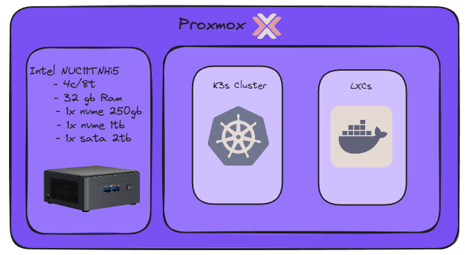
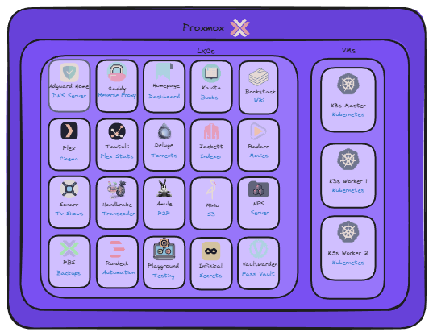

# Proxmox

Proxmox is a **Type 1 hypervisor** based on KVM—essentially _Debian + KVM + GUI_.  
It's my homelab choice because it's pure Linux under the hood and doesn't require special hardware like ESXi.

---

## Hardware Overview

This is the hardware used for hosting Proxmox:



**Storage distribution:**
- **NVME 2242 256GB:** `Proxmox OS`, `VM ISOs`, and `Container templates`
- **NVME 2280 1TB:** `VMs and CTs storage`
- **HDD 2.5 2TB:** `Media`

---

## Self-Hosted Services

Currently hosted on my NUC:



### VMs (K3s cluster)
- [ArgoCD](/kubernetes/argocd/clusters/addons/software-base/argocd): GitOps for automated deployments
- [Certmanager](/kubernetes/argocd/clusters/addons/software-base/cert-manager): Automated certificate management
- [External-dns](/kubernetes/argocd/clusters/addons/software-base/external-dns): Dynamic DNS updater
- [External-secrets](/kubernetes/argocd/clusters/addons/software-base/external-secrets): Secure secrets management
- [MetalLB](/kubernetes/argocd/clusters/addons/software-base/metallb): Layer 2 LoadBalancer (pool `192.168.1.80-100`)
- [Istio Base](/kubernetes/argocd/clusters/addons/software-base/istio-base): Istio CRDs
- [Istiod](/kubernetes/argocd/clusters/addons/software-base/istiod): Istio control plane
- [Istio Ingress Gateway](/kubernetes/argocd/clusters/addons/software-base/istio-ingressgateway): Istio ingress proxy (LoadBalancer)
- [Kiali](/kubernetes/argocd/clusters/addons/monitoring/kiali): Service mesh observability dashboard
- [NFS](/kubernetes/argocd/clusters/addons/software-base/nfs): CSI driver
- [Prometheus](/kubernetes/argocd/clusters/addons/monitoring/prometheus): Metrics and monitoring (remote writer)
- [Promtail](/kubernetes/argocd/clusters/addons/monitoring/promtail): Centralized logging
- [Tailscale](/kubernetes/argocd/clusters/addons/software-base/tailscale): Zero-config VPN for secure networking
- [Velero](/kubernetes/argocd/clusters/addons/software-base/velero): Backup and restore solution

### LXCs
- [Adguard](/docker/adguard): Adblock + DNS server
- [Amule](/docker/amule): P2P downloads
- Bots: Telegram bots (LXC 129)
- [Bookstack](/docker/bookstack): Wiki
- [Caddy](/docker/caddy): Reverse proxy
- [Deluge](/docker/deluge): Torrent downloads
- [Handbrake](/docker/handbrake): Transcoder
- [Homepage](/docker/homepage): Dashboard
- [Infisical](/docker/infisical): Secrets management
- [Jackett](/docker/jackett): Trackers
- [Kavita](/docker/kavita): Library
- [Minio](/docker/minio): S3 storage
- [Plex](/docker/plex): Media player
- [Radarr](/docker/radarr): Movie manager
- [Rancher](/docker/rancher): Kubernetes management
- [Sonarr](/docker/sonarr): TV show manager
- [Tautulli](/docker/tautulli): Plex stats
- [Vaultwarden](/docker/vaultwarden): Password vault

---

## Proxmox Addons

While I don't recommend heavy customization of the Proxmox host, I do use a couple of helpful addons:
- **Tailscale:** Remote access from anywhere
- **PVE exporter:** Scrape metrics and store them securely (I use Tailscale in order to expose those metrics safely)

---

## Proxmox Metrics

I use [PVE exporter](/observability/prometheus/README.md) to expose all metrics from Proxmox VMs and LXCs.

---

## Proxmox Template Creation

Rancher creates every cluster node by cloning a `cloud-init` template. The template must have the QEMU guest agent and use `x86-64-v2-AES` as CPU type (required by the node driver).

**Steps to create the template (VMID `200`):**
```sh
wget https://cloud.debian.org/images/cloud/trixie/latest/debian-13-genericcloud-amd64.qcow2
virt-customize -a debian-13-genericcloud-amd64.qcow2 --install qemu-guest-agent --run-command 'systemctl enable qemu-guest-agent' --truncate /etc/machine-id
qemu-img resize debian-13-genericcloud-amd64.qcow2 20G
qm create 200 --name debian-13 --memory 2048 --cores 2 --cpu x86-64-v2-AES --net0 virtio,bridge=vmbr0 --scsihw virtio-scsi-single --agent 1 --serial0 socket --vga serial0 --ostype l26
qm importdisk 200 debian-13-genericcloud-amd64.qcow2 local-lvm
qm set 200 --scsi0 local-lvm:vm-200-disk-0,discard=on,ssd=1 --boot order=scsi0
qm set 200 --ide2 local-lvm:cloudinit
qm template 200
```

**Pool and permissions for Rancher:** the template and every node live in the `rancher-managed` pool. The `rancher@pve` user (and its API token) only has the `RancherPVENode` role on that pool, plus `Sys.Audit`, `Datastore.Audit`, `Datastore.AllocateSpace` and `SDN.Use` on `/`, so a leaked token cannot touch the rest of the VMs and LXCs.
```sh
pveum pool add rancher-managed
pveum pool modify rancher-managed --vms 200
```

**Extra packages without rebuilding the template:** nodes get `nfs-common` (needed by the NFS CSI driver) from a cloud-init vendor snippet, referenced as `cicustom: vendor=local:snippets/rancher.yaml` in the `PveConfig`:
```yaml
#cloud-config
package_update: true
packages:
  - nfs-common
```
